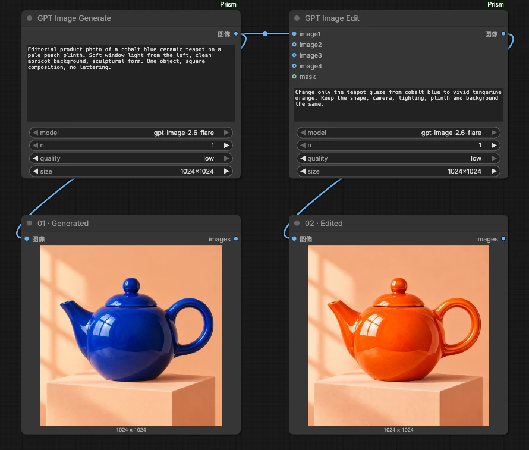
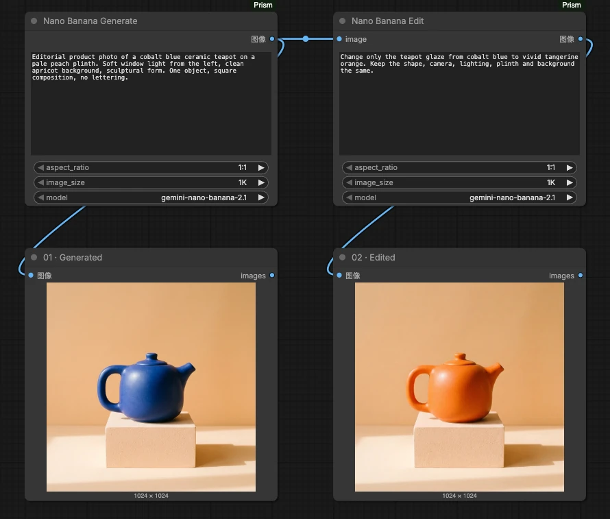

# ComfyUI Prism

Prism 把 OpenAI 和 Google Nano Banana（通过 Gemini API）的官方图像接口 接入 ComfyUI。你可以用提示词生成图片，也可以把已有图片接入编辑节点，修改画面中的物体、颜色或构图。图像由所选服务处理，结果以 ComfyUI 的 `IMAGE` 类型返回，可直接接入后续工作流。

## 安装

在 ComfyUI 根目录打开终端，使用运行 ComfyUI 的 Python 环境执行：

```sh
git clone https://github.com/jiaqianjing/ComfyUI-Prism.git custom_nodes/ComfyUI-Prism
python -m pip install -r custom_nodes/ComfyUI-Prism/requirements.txt
```

## 配置官方 API 密钥

只需设置你要使用的服务。OpenAI 节点读取 `OPENAI_API_KEY`，Gemini 节点读取 `GEMINI_API_KEY`。密钥可以在对应的官方控制台创建。[OpenAI API Keys](https://platform.openai.com/api-keys) · [Google AI Studio](https://aistudio.google.com/apikey)

把插件目录中的 `config.ini.example` 复制为同目录的 `config.ini`，填入所用服务的密钥并保存：

```ini
[api_keys]
GEMINI_API_KEY =
OPENAI_API_KEY =
```

重启 ComfyUI 后生效。节点优先读取文件中对应的密钥，留空时读取同名环境变量。`config.ini` 已加入 Git 忽略列表。

## 生成第一张图

1. 在画布上双击，搜索 `GPT Image Generate`。如果配置的是 Gemini 密钥，选择 `Nano Banana Generate`。
2. 在 `prompt` 中输入「清晨的窗边，一只透明玻璃杯在木桌上投下淡蓝色的影子」，其余参数保留默认值。
3. 将节点的 `IMAGE` 输出连接到 `Preview Image`，运行工作流即可查看结果。要保存文件，可连接 `Save Image`。

## 编辑已有图片

添加 `Load Image` 并选择原图，然后从下表选择编辑节点。将原图接入指定端口，在 `prompt` 中描述具体改动，例如「把玻璃杯换成白色陶瓷杯，保留原来的光线和背景」。

| 节点（Prism 分类） | 输入与选项 |
| --- | --- |
| GPT Image Generate | 输入提示词，选择质量和尺寸。用 `n` 设置一次生成的张数，范围为 1–10。 |
| GPT Image Edit | 将原图接入 `image1`。`image2` 至 `image4` 可添加参考图，`mask` 可指定编辑区域。 |
| Nano Banana Generate | 输入提示词，选择模型、宽高比和分辨率。 |
| Nano Banana Edit | 将一张参考图接入 `image`，输入编辑提示词，选择输出宽高比和分辨率。 |

编辑节点同样输出 `IMAGE`。如果需要比较编辑前后的效果，可将原图和编辑结果分别连接到两个 `Preview Image` 节点。

## 实际工作流

以下两组均为 ComfyUI 实测，使用同样的生成和编辑提示词。

### OpenAI GPT Image 2.6 Flare

左侧用 `GPT Image Generate` 生成一只蓝色茶壶，右侧将生成图直接传给 `GPT Image Edit`，只修改釉色。两张预览分别是生成结果和编辑结果，模型均为 `gpt-image-2.6-flare`，尺寸为 1024×1024。



### Google Nano Banana 2.1

左侧用 `Nano Banana Generate` 生成蓝色茶壶，右侧用 `Nano Banana Edit` 将同一张图的釉色改为橙色。两步均使用 `gemini-nano-banana-2.1`、1:1、1K 设置。



## 模型与输出选项

| 插件内可选模型 | 节点支持的输出选项 |
| --- | --- |
| `gpt-image-2.6-flare`（默认） | 尺寸支持自动、1024×1024、1536×1024、1024×1536；质量支持自动、高、中、低。 |
| Nano Banana 2.1（默认，`gemini-nano-banana-2.1`） | 1K、2K 或 4K，支持下列五种宽高比。 |
| Nano Banana Pro（`gemini-3-pro-image`） | 1K 或 2K，支持 1:1、9:16、16:9、4:3、3:4。 |
| Nano Banana 2 Lite（`gemini-3.1-flash-lite-image`） | 1K，支持上述五种宽高比。 |

如果节点提示缺少密钥，请检查插件目录下 `config.ini` 的 `[api_keys]` 中是否填写了对应服务的密钥，保存后重启 ComfyUI。如果使用环境变量，请确认运行 ComfyUI 的进程能读取该变量。如果 Nano Banana 2 Lite提示分辨率不受支持，请将 `image_size` 设为 `1K`。

**升级旧工作流：** 如果 GPT 生成或编辑节点保存了旧模型（例如 `gpt-image-1.5` 或云雾的 `gpt-image-2-all`），请更新插件并重启 ComfyUI，在原节点的 `model` 下拉框重新选择 `gpt-image-2.6-flare` 后保存。节点 ID 和连线不变；旧模型名不会被静默替换。

**Google 节点更名：** 原有 Gemini 生成和编辑节点的 ID、连线、已保存的模型 ID 和 `GEMINI_API_KEY` 均保持不变。新建节点默认使用 Nano Banana 2.1；旧工作流要升级时，在 `model` 下拉框选择 `gemini-nano-banana-2.1` 即可。2.1 走 Google 官方 Interactions API（请求设置 `store: false`），Pro 和 Lite 继续走 GenerateContent。
